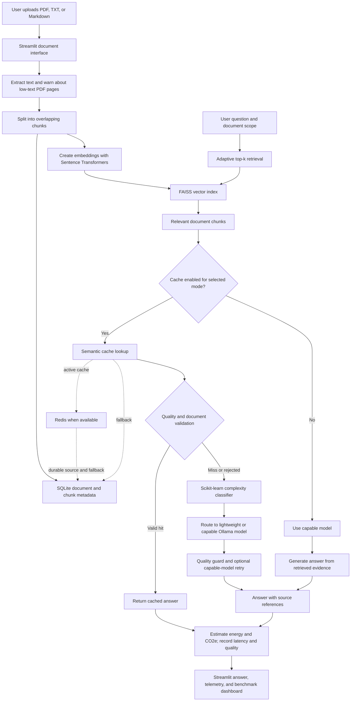

# GreenRouting Energy-Aware Retrieval-Augmented Generation Framework

## CHAPTER 2: LITERATURE SURVEY — PAGE NO 3

Retrieval-Augmented Generation (RAG) combines a language model with a retriever that selects relevant external passages for a query. Lewis et al. introduced a RAG formulation in which retrieved evidence supplements the model’s generated response. This is useful for document question-answering because the application can ground answers in user-provided files instead of relying only on information stored in model parameters. GreenRouting follows this general pattern: it indexes document chunks, retrieves relevant passages, and supplies them to a local language model. [Lewis et al., 2020](https://papers.nips.cc/paper/2020/hash/6b493230205f780e1bc26945df7481e5-Abstract.html)

Efficient similarity search is important when a system stores document embeddings. Johnson, Douze, and Jégou describe FAISS methods for nearest-neighbour search over high-dimensional vectors. GreenRouting uses the FAISS CPU library to locate document chunks whose embeddings are similar to a query. This project uses FAISS for local retrieval; it does not claim the scale or performance results of the paper. [Johnson et al., 2017](https://arxiv.org/abs/1702.08734)

Schwartz et al. argue that AI research should report computational efficiency alongside model quality. This motivates measuring both answer quality and estimated energy or carbon impact in GreenRouting. The project’s energy values are engineering estimates based on configured power assumptions and model-generation time, so they are intended for comparisons under the same setup rather than as direct hardware measurements. [Schwartz et al., 2020](https://arxiv.org/abs/1907.10597)

FrugalGPT studies strategies such as model cascades that select different language-model paths to manage cost and performance. GreenRouting applies a related idea locally: it routes queries between a lightweight and a capable Ollama model and can retry with the capable model when the quality guard detects a weak lightweight answer. The routing logic here is a prototype and is not the learned cascade proposed by FrugalGPT. [Chen et al., 2023](https://arxiv.org/abs/2305.05176)

Optuna provides a framework for searching parameter settings. GreenRouting uses it in an experimental, bounded search over routing and semantic-cache thresholds. The search minimizes measured energy while treating a minimum project quality score as a constraint. Its recommendation depends on the selected questions, the local models, and the project’s heuristic quality score; it is not a universal optimum. [Akiba et al., 2019](https://doi.org/10.1145/3292500.3330701)

Together, these works support the project’s design choices: retrieve evidence for grounded answers, use vector search for document lookup, measure efficiency with quality, and select inference paths according to query needs. GreenRouting combines these ideas in a local document assistant and exposes the decisions and estimated impact through a dashboard.

## CHAPTER 3: PROBLEM STATEMENT — PAGE NO 4

A conventional document RAG application may send every question to the same large language model, even when a small model could handle a simple factual question. Repeated or semantically similar questions may also trigger repeated model inference. These choices can increase response time and computation, while the application may provide little visibility into the quality, energy estimate, carbon estimate, model choice, or document evidence behind an answer.

The project addresses the following problem: **How can a local document question-answering system reduce avoidable language-model computation while retaining useful, document-grounded answers and making its decisions measurable and explainable?**

For a set of indexed documents and user questions, the system should retrieve relevant evidence, answer from the selected document scope, reuse a cached answer only after validation, route a cache miss to an appropriate local model, and retry with a capable model when the lightweight answer fails the configured quality check. It should report latency, a modeled energy estimate, a modeled CO₂e estimate, grounding and quality scores, and source references.

The project does not train a language model on uploaded files. Uploaded content is extracted, divided into chunks, embedded, and indexed so it can be retrieved at question time. The quality and energy figures are estimates from the prototype’s evaluation logic and configured power assumptions; they are not certified factuality scores or direct power-meter readings.

## CHAPTER 4: PROPOSED SOLUTION AND IMPLEMENTATION — PAGE NO 5–7

GreenRouting is a local, multi-document question-answering application built with Python and Streamlit. A user uploads text-based PDF, TXT, or Markdown files. The application extracts readable text, splits it into overlapping chunks, creates embeddings, and stores the vectors and document metadata for retrieval. PDF pages with little or no extracted text produce a warning because scanned-page OCR is not implemented.

For each question, the application selects a document scope and chooses a retrieval depth. It then retrieves the most relevant chunks and, in cache-enabled modes, checks for a semantically similar cached answer. A candidate is returned only after document-scope, source-support, freshness, and grounding checks. Otherwise, GreenRouting routes the question to the lightweight or capable local Ollama model. A low-quality lightweight response can be retried with the capable model.

The project presents three execution strategies for comparison:

| Strategy | Cache | Model selection | Purpose |
|---|---|---|---|
| `STANDARD_RAG` | Disabled | Capable model | Baseline for comparison |
| `RAG_WITH_CACHE` | Semantic cache with validation | Capable model on a cache miss | Measures the effect of cache reuse |
| `GREENROUTING` | Quality-aware semantic cache | Adaptive lightweight/capable routing with quality retry | Combines the energy-aware features |

The dashboard reports answer sources and estimated environmental impact so a user can compare these strategies on the same document and query set. The benchmark stores query-level results and summaries in SQLite and presents comparison charts in the Streamlit interface.

## CHAPTER 5: SYSTEM ARCHITECTURE

### 5.1 Architecture Workflow Diagram — PAGE NO 8



The workflow separates document ingestion from question answering. Ingestion builds a searchable local index. At query time, retrieval and cache validation happen before model generation. A verified cache hit avoids language-model inference; a miss proceeds through model routing and quality checks. Redis stores active cache entries when connected, while SQLite remains the durable source and fallback.

### 5.2 Comprehensive System Design and Implementation Framework — PAGE NO 9–11

| Component | Implementation | Role in the system |
|---|---|---|
| User interface | Streamlit | Provides document upload, question answering, execution-mode selection, cache inspection, benchmarking, and architecture information. |
| Document ingestion | Python, PyPDF, UTF-8 text extraction | Accepts text-based PDF, TXT, and Markdown files; records a warning for PDF pages with limited extracted text. OCR is not included. |
| Chunking | Configured chunk size of 500 characters and overlap of 50 characters | Keeps document passages small enough for retrieval while retaining some surrounding context. |
| Embeddings | Sentence Transformers, `all-MiniLM-L6-v2` | Converts query and document text into vectors for semantic similarity search. |
| Vector retrieval | FAISS CPU | Finds relevant document chunks. Retrieval depth can be reduced for simple questions and increased for analytical questions. |
| Document metadata | SQLite | Persists document records, chunk text, query history, and benchmark summaries. |
| Semantic cache | Redis with SQLite source and fallback | Stores active cache entries in Redis when available. Cache validation checks similarity, document scope, source support, freshness, and grounding before answer reuse. |
| Local language models | Ollama; configured defaults `qwen2.5:0.5b` and `llama3.2:3b` | Generates answers locally. The smaller model is used for lower-complexity queries; the capable model handles more complex queries and retries. |
| Query complexity | scikit-learn TF-IDF and Logistic Regression, with rule-based fallback | Predicts simple or complex query classes from a small built-in labeled set. Low-confidence predictions use explainable rules. This is a starter classifier, not a model trained on uploaded documents. |
| Quality checks | Project evaluator and quality guard | Estimates grounding from text overlap and checks for short or refusal-like answers. A lightweight answer below the configured threshold can be retried with the capable model. |
| Energy and carbon | Configured CPU/GPU power profiles and elapsed generation time | Calculates modeled energy and CO₂e with a configured grid-emissions factor. It does not read hardware power sensors or a live electricity-grid API. |
| Benchmark and tuning | pandas, Plotly, Optuna | Compares the three execution strategies and offers a bounded experimental search over routing and cache thresholds, subject to a minimum heuristic quality score. |

The default retrieval and routing configuration uses `top_k_retrieval = 3`, a routing complexity threshold of `0.50`, a semantic-cache similarity threshold of `0.70`, and a minimum acceptable quality score of `0.55`. These are configurable starting values, not universal settings.

The energy model converts power and elapsed generation time into an estimate:

```text
energy_kWh = power_watts × generation_seconds / 3,600,000
emissions_kg_CO2e = energy_kWh × configured_grid_factor_kg_per_kWh
```

For a cache hit, the application reports a low-power retrieval estimate because validation and retrieval still use computation even though language-model inference is avoided. The dashboard labels these values as modeled estimates.

### 5.3 AI and Machine Learning Logic (System Intelligence) — PAGE NO 11–14

**Document retrieval.** The system embeds document chunks and the user’s question in the same vector space. FAISS returns nearby chunks, restricted to the selected document when the user chooses a document scope. The adaptive retrieval policy uses query length and analytical markers such as “compare,” “analyze,” and “evaluate” to select a bounded `top_k`. Short factual questions use a smaller context; longer or analytical questions can use more chunks. This is a deterministic policy, not a learned retrieval model.

**Quality-aware caching.** For `RAG_WITH_CACHE` and `GREENROUTING`, the semantic cache compares the question embedding with cached question embeddings. A similarity match alone is insufficient: the application checks the document scope and supporting source context, cache age, and grounding conditions before reusing the answer. Redis is the active cache backend when available. SQLite remains the durable source and fallback. Invalid or stale candidates are rejected and the query continues through normal generation.

**Adaptive model routing.** GreenRouting analyzes query complexity with a scikit-learn pipeline using TF-IDF features and Logistic Regression. The built-in classifier uses a small, manually labeled starter set of simple and complex question examples. When the classifier is uncertain, the application falls back to the existing rule-based analyzer, which uses query length, reasoning terms, syntax, and technical vocabulary. The configured complexity threshold determines the rule-based route. The starter classifier requires more representative labeled data before its classification performance can be generalized.

**Quality retry.** After a lightweight model responds, the quality guard checks token overlap with retrieved context, response length, and uncertainty or refusal phrases. If the response falls below the configured score, GreenRouting can retry with the capable model. This score is a project heuristic; it should not be presented as a human evaluation or as a RAGAS score.

**Quality-constrained parameter search.** The optional Optuna function searches the routing threshold and cache similarity threshold within bounded ranges. Each trial runs the selected evaluation questions through GreenRouting, measures total modeled energy and average project quality score, then marks whether the minimum quality floor was met. The recommendation is the lowest-energy tested trial that satisfies that floor. The tuner restores the original thresholds after its search and displays recommendations without silently changing normal app settings. The test results depend on the document, question set, local models, and heuristic evaluator. Optuna must be installed from `requirements.txt` before using this control.

## CHAPTER 6: EXPERIMENTAL SETUP AND RESULT ANALYSIS

The prototype is evaluated locally with Python 3.11, Streamlit, Ollama, FAISS CPU, SQLite, Redis when available, and the configured Sentence Transformers embedding model. The configured Ollama models are `qwen2.5:0.5b` and `llama3.2:3b`. The repository includes sample ANN PDFs in `test_docs/` for document ingestion and question-answering checks.

The comparative benchmark runs the same evaluation questions against `STANDARD_RAG`, `RAG_WITH_CACHE`, and `GREENROUTING`. It records latency, modeled energy, modeled CO₂e, answer quality, grounding, cache hits, model selection, and retries. Cache state is isolated between strategy runs and restored afterward. Meaningful comparisons should use the same indexed documents, question list, model configuration, and machine state.

The project test suite passed **76 tests** in the latest run. These checks include routing, retrieval, cache validation, document handling, benchmarking, and threshold-optimizer logic. The optimizer tests use a controlled Optuna test double because Optuna is not installed in the active environment. No saved comparative benchmark record was present in the repository database when this report was prepared; therefore this report does not claim a numerical energy or carbon reduction. Run the live benchmark after installing dependencies and record its displayed values before presenting measured results.

### 6.1 Code Snippets — PAGE NO 15–16

The following excerpts show the project’s main decisions. They are shortened for the report; the full implementation is in the corresponding source modules.

**Adaptive retrieval depth** (`greenrouting/retrieval_policy.py`):

```python
retrieval_decision = choose_top_k(
    query=query,
    available_chunks=available_chunks,
    default_top_k=self.settings.rag.top_k_retrieval,
)
k = retrieval_decision.top_k
```

**Model selection and quality retry** (`greenrouting/adaptive_router.py`):

```python
if is_complex:
    initial_model = self.model_config.capable_model
else:
    initial_model = self.model_config.lightweight_model

quality_assessment = self.quality_guard.evaluate_answer(...)
if quality_assessment["should_retry"]:
    retry_model = self.model_config.capable_model
    # Generate and evaluate the capable-model response.
```

**Energy and carbon estimate** (`greenrouting/energy_tracker.py`):

```python
energy_kwh = power_watts * generation_seconds / (3600.0 * 1000.0)
emissions_kg = energy_kwh * self.config.emission_factor_kg_per_kwh
```

### 6.2 Web Preview — PAGE NO 16–17

The Streamlit application is organized into five tabs:

| Tab | What appears in the application |
|---|---|
| Green RAG Assistant | Question templates, document scope, execution strategy, answer, source citations, cache and routing decisions, latency, quality, grounding, energy, and carbon estimates. |
| Document Knowledge Base | Multi-file upload, indexing status, document and chunk counts, extraction warnings, sample-document loading, and document deletion with index rebuilding. |
| Semantic Cache Inspector | Cache entries and their validation information, with controls to inspect or clear cached data. |
| Experimental Benchmarking | Comparison of the three execution strategies, benchmark metrics and charts, plus the Optuna threshold-tuning control. |
| Architecture & Methodology | Explanation of the system workflow, components, decisions, and measurement method. |

For the final formatted submission, capture screenshots from the running application for the Green RAG Assistant, its answer with citations and telemetry, the Document Knowledge Base, and the benchmark charts. The repository currently has no saved UI screenshot assets, so no screenshot is embedded in this Markdown draft.
